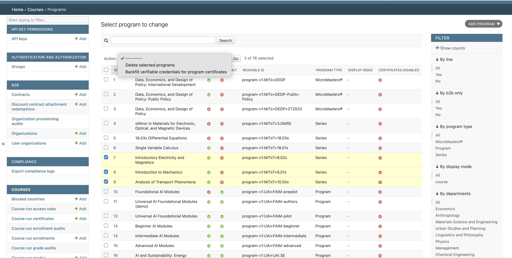

# Backfilling Verifiable Credentials

This page covers when verifiable credentials are created automatically, the ways to create them for certificates that don't have one, and what to [check before](#checking-certificate-page-configuration) and after a backfill.

## How credentials are normally created

Every path, automatic or manual, goes through `courses.api.create_verifiable_credential()`. It:

1. Finds the `CertificatePage` that the certificate's `certificate_page_revision` belongs to and reads the page's latest published version. It does not use the revision that was in place when the certificate was issued, so fixing a page later lets you backfill certificates issued earlier.
2. Checks that the page is eligible (at the time of writing, this means the certificate page having a value for `verifiable_credential_criteria` and `should_provision_verifiable_credential=True`. If those are not populated, it returns without doing anything and without raising an error.
3. Builds the credential payload: the learner's current name, the course or program URL, the page's criteria (and its description, if the `mitxonline-credential-metadata-authoring` feature flag is on), the feature image, the enrollment date and the certificate issue date.
4. Sends the payload to the signer at `VERIFIABLE_CREDENTIAL_SIGNER_URL`, authenticating with `VERIFIABLE_CREDENTIAL_BEARER_TOKEN`.
5. Saves the signed response as a `VerifiableCredential` record and links it to the certificate via one-to-one field.

When a certificate is issued, any error in these steps is logged to Sentry (`Error creating verifiable credential for certificate <uuid>`) and then swallowed. The certificate is still issued, just without a credential. The backfill tools pass `raise_on_error=True`, so they can report which certificates failed.

### Admin actions (`VerifiableCredentialBackfillAdminMixin`)

Two admin pages have a backfill action:

| Admin page | Action label | Certificates processed                                                           |
|---|---|----------------------------------------------------------------------------------|
| Courses › Programs (`/admin/courses/program/`) | *Backfill verifiable credentials for program certificates* | Active `ProgramCertificate` records for the selected programs with no credential |
| Courses › Course runs (`/admin/courses/courserun/`) | *Backfill verifiable credentials for course run certificates* | Active `CourseRunCertificate` records for the selected runs with no credential   |



To use it:

1. Check the `CertificatePage` configuration for required fields in the CMS. See [Checking certificate page configuration](#checking-certificate-page-configuration) for details.
2. Open the Programs or Course runs list, tick the rows you want, choose the backfill action from the **Action** dropdown, and click **Go**.
3. Read the message shown at the top of the page:
   - **Info**: `Successfully requested verifiable credential backfill for N program certificates.` (or `courserun certificates`). *N* counts every certificate that had no credential, **including ones skipped because their page isn't eligible**, so be advised that it isn't a count of credentials created.
   - **Warning**: the same message plus `...but encountered errors for certificates with IDs: [...]`. The IDs are the primary keys of the certificates which encountered errors while provisioning. Look up the details in Sentry (`Error creating verifiable credential for certificate <uuid>`).

Things to know:

- The action never touches certificates that already have a credential, so you can safely run it again. Reissuing an existing credential requires using the `backfill_verifiable_credentials` management command with `--force`.
- It runs synchronously, making one signer request per certificate. A large selection can run into the web request timeout. In that case, use the management command.

### Management command

`backfill_verifiable_credentials` is designed for individual and bulk backfills that can't easily be performed via the UI and requiring production shell access. For full option reference consult the command itself. A few examples are shown below.

The following commands can be run from a web or celery worker container.

```bash
# Dry run: list the certificates for a program by courseware ID which would be processed, without creating any credentials. Note that this output will include certificates without correctly configured CertificatePages.
manage.py backfill_verifiable_credentials --type program --ids program-v1:MITx+DEDP

# Execute backfill for a program by courseware ID, pausing half a second between signer calls
manage.py backfill_verifiable_credentials --type program --ids program-v1:MITx+DEDP \
    --execute --sleep 0.5

# Backfill all certificates for a set of courses by comma-separated courseware IDs.
manage.py backfill_verifiable_credentials --type course --ids course-v1:MITx+14.73x+1T2024,course-v1:MITx+14.73x+3T2024 --execute

# Backfill a single certificate by its UUID, forcing a reissue if it already has a credential. This is useful for correcting the criteria text or after a learner changes their name.
manage.py backfill_verifiable_credentials --uuid 3f1c0e2a-0000-0000-0000-000000000000 --execute --force
```

Note that `--force` deletes the existing credential non-transactionally *before* requesting a new one.

## Checking certificate page configuration
As noted earlier, verifiable credentials are only populated if the corresponding CertificatePages has a value for `verifiable_credential_criteria` and `should_provision_verifiable_credential=True`. If those are not populated, a verifiable credential will not be created for an issued Certificate.
This can be checked manually, but it can also be checked via the `check_verifiable_credential_config` management command for specific Programs or Courses or by visiting the `/admin/courses/verifiablecredential/stats/` page to see a summary of all Programs and Courses with their configuration status.
